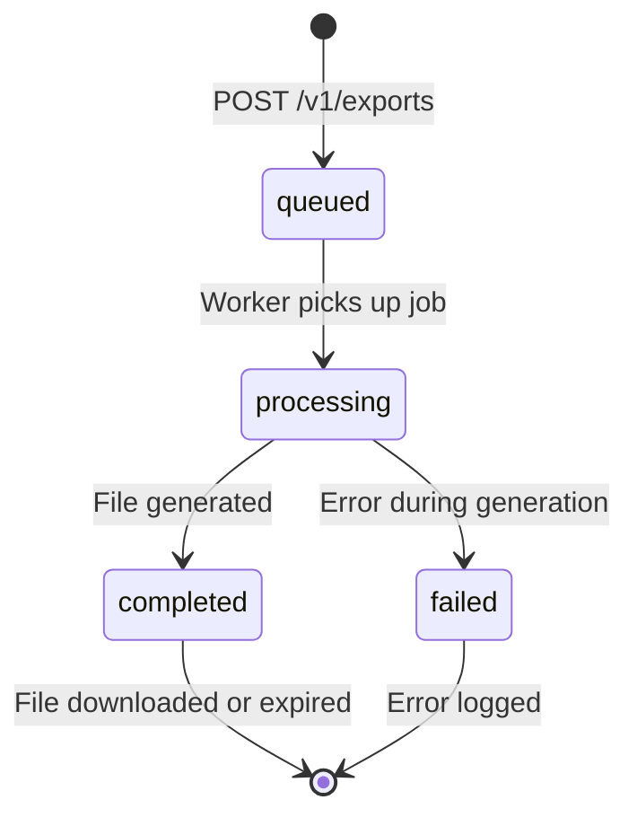

# Exports

## Overview

FacilPay supports asynchronous background exports for large datasets. Instead of blocking the request thread, exports are enqueued as background jobs that run in a worker process. The caller receives a job ID immediately and polls for status until the file is ready.

Exports are ideal for datasets that are too large to generate synchronously (thousands of payments, long date ranges, etc.). For small exports, use the synchronous `GET /v1/payments/export` endpoint instead.

---

## Supported Export Types

| Type | Description | Status |
|------|-------------|--------|
| `payments` | Export payment records with filters | ✅ Implemented |
| `ledger` | Merchant balance ledger entries; columns are listed in [Ledger](LEDGER.md#csv-export) | ✅ Implemented |

Future export types (invoices, settlements, etc.) will follow the same API pattern.

---

## Supported Formats

| Format | Description | Content-Type |
|--------|-------------|--------------|
| `csv` | Comma-separated values | `text/csv` |
| `pdf` | PDF document | `application/pdf` |

---

## Lifecycle



| Status | Description |
|--------|-------------|
| `queued` | Job is waiting in the queue |
| `processing` | Worker is generating the file |
| `completed` | File is ready for download |
| `failed` | Job failed with an error |

---

## Creating an Export

```
POST /v1/exports
Authorization: Bearer <access_token>
```

**Request Body:**
```json
{
  "type": "payments",
  "format": "csv",
  "filters": {
    "from": "2026-01-01",
    "to": "2026-01-31",
    "status": "COMPLETED",
    "currency": "USD"
  }
}
```

- `type` (required) — Export type. Currently only `payments` is supported.
- `format` (required) — Output format. Either `csv` or `pdf`.
- `filters` (optional) — Filters to apply. For `payments`, accepts the same query params as `GET /v1/payments`.

**Response (202 Accepted):**
```json
{
  "id": "550e8400-e29b-41d4-a716-446655440000",
  "status": "queued",
  "type": "payments",
  "format": "csv",
  "createdAt": "2026-10-17T10:00:00.000Z"
}
```

The job ID is returned immediately. The file generation happens in the background.

**Response (400 Bad Request):**
```json
{
  "statusCode": 400,
  "message": "Unsupported export type: invoices",
  "error": "Bad Request"
}
```

**Response (401 Unauthorized):**
```json
{
  "statusCode": 401,
  "message": "Authentication required",
  "error": "Unauthorized"
}
```

---

## Polling for Status

```
GET /v1/exports/:id
Authorization: Bearer <access_token>
```

**Response (200 OK — queued):**
```json
{
  "id": "550e8400-e29b-41d4-a716-446655440000",
  "status": "queued",
  "type": "payments",
  "format": "csv",
  "error": null,
  "createdAt": "2026-10-17T10:00:00.000Z",
  "completedAt": null,
  "expiresAt": null,
  "downloadUrl": null
}
```

**Response (200 OK — processing):**
```json
{
  "id": "550e8400-e29b-41d4-a716-446655440000",
  "status": "processing",
  "type": "payments",
  "format": "csv",
  "error": null,
  "createdAt": "2026-10-17T10:00:00.000Z",
  "completedAt": null,
  "expiresAt": null,
  "downloadUrl": null
}
```

**Response (200 OK — completed):**
```json
{
  "id": "550e8400-e29b-41d4-a716-446655440000",
  "status": "completed",
  "type": "payments",
  "format": "csv",
  "error": null,
  "createdAt": "2026-10-17T10:00:00.000Z",
  "completedAt": "2026-10-17T10:02:34.000Z",
  "expiresAt": "2026-10-24T10:02:34.000Z",
  "downloadUrl": "https://api.facilpay.com/v1/exports/550e8400-e29b-41d4-a716-446655440000/download?expires=1729756954000&token=abc123def456"
}
```

**Response (200 OK — failed):**
```json
{
  "id": "550e8400-e29b-41d4-a716-446655440000",
  "status": "failed",
  "type": "payments",
  "format": "csv",
  "error": "No payments export source configured",
  "createdAt": "2026-10-17T10:00:00.000Z",
  "completedAt": "2026-10-17T10:00:15.000Z",
  "expiresAt": null,
  "downloadUrl": null
}
```

**Response (404 Not Found):**
```json
{
  "statusCode": 404,
  "message": "Export not found",
  "error": "Not Found"
}
```

**Response (403 Forbidden):**
```json
{
  "statusCode": 403,
  "message": "Export belongs to another user",
  "error": "Forbidden"
}
```

---

## Downloading the File

When the status is `completed`, the `downloadUrl` contains a signed, expiring link. The link is valid until `expiresAt` (default 7 days after completion).

```
GET /v1/exports/:id/download?expires=<timestamp>&token=<signature>
Authorization: Bearer <access_token>
```

The URL includes:
- `expires` — Unix timestamp (milliseconds) when the link expires
- `token` — HMAC signature binding the job ID, owner ID, and expiry time

**Response (200 OK):**
```
Content-Type: text/csv
Content-Disposition: attachment; filename="payments-export-550e8400-e29b-41d4-a716-446655440000.csv"

id,amount,currency,status,createdAt
pay_123,1000,USD,COMPLETED,2026-01-15T10:00:00.000Z
pay_456,2000,USD,COMPLETED,2026-01-16T11:00:00.000Z
...
```

The file streams directly from storage to the response, so memory usage is bounded regardless of file size.

**Response (400 Bad Request):**
```json
{
  "statusCode": 400,
  "message": "Export is not ready for download",
  "error": "Bad Request"
}
```

**Response (403 Forbidden):**
```json
{
  "statusCode": 403,
  "message": "Download link has expired",
  "error": "Forbidden"
}
```

**Response (404 Not Found):**
```json
{
  "statusCode": 404,
  "message": "Export not found",
  "error": "Not Found"
}
```

---

## Retention and Expiry

- Generated files are retained for **7 days** by default (configurable via `retentionDays`).
- After expiry, files are purged from storage and the export record is deleted.
- The `downloadUrl` becomes invalid after `expiresAt`.

A scheduled task runs periodically to remove expired exports.

---

## Synchronous vs. Asynchronous Exports

| Feature | Synchronous (`GET /v1/payments/export`) | Asynchronous (`POST /v1/exports`) |
|---------|----------------------------------------|-----------------------------------|
| Response time | Immediate | Deferred (poll for status) |
| Best for | Small datasets (<1000 rows) | Large datasets (1000+ rows) |
| Memory usage | Entire dataset in memory | Streamed in batches |
| Job tracking | None | Persistent job ID |
| File expiry | N/A | 7 days |
| Background processing | No | Yes |

**When to use asynchronous exports:**
- Exporting thousands of payments
- Large date ranges
- When the synchronous endpoint times out
- When you need a persistent download link

**When to use synchronous exports:**
- Small result sets (<1000 rows)
- Immediate download required
- No need for job tracking

---

## Complete curl Walkthrough

```bash
# 1. Log in to get an access token
ACCESS_TOKEN=$(curl -s -X POST http://localhost:3000/v1/auth/login \
  -H "Content-Type: application/json" \
  -d '{"email":"merchant@example.com","password":"P@ssw0rd!"}' \
  | jq -r '.access_token')

# 2. Create an export job
EXPORT_ID=$(curl -s -X POST http://localhost:3000/v1/exports \
  -H "Authorization: Bearer $ACCESS_TOKEN" \
  -H "Content-Type: application/json" \
  -d '{
    "type": "payments",
    "format": "csv",
    "filters": {
      "from": "2026-01-01",
      "to": "2026-01-31",
      "status": "COMPLETED"
    }
  }' | jq -r '.id')

echo "Export ID: $EXPORT_ID"

# 3. Poll for status (repeat until status is "completed")
while true; do
  STATUS=$(curl -s -X GET "http://localhost:3000/v1/exports/$EXPORT_ID" \
    -H "Authorization: Bearer $ACCESS_TOKEN" | jq -r '.status')
  echo "Status: $STATUS"
  if [ "$STATUS" = "completed" ] || [ "$STATUS" = "failed" ]; then
    break
  fi
  sleep 2
done

# 4. Get the download URL
DOWNLOAD_URL=$(curl -s -X GET "http://localhost:3000/v1/exports/$EXPORT_ID" \
  -H "Authorization: Bearer $ACCESS_TOKEN" | jq -r '.downloadUrl')

echo "Download URL: $DOWNLOAD_URL"

# 5. Download the file
curl -X GET "$DOWNLOAD_URL" \
  -H "Authorization: Bearer $ACCESS_TOKEN" \
  -o payments-export.csv

echo "File downloaded: payments-export.csv"
```

---

## Configuration

Exports are configured via environment variables (typically injected when instantiating `ExportsService`):

| Variable | Description | Default |
|----------|-------------|---------|
| `REDIS_HOST` | Redis host for BullMQ queue | `localhost` |
| `REDIS_PORT` | Redis port | `6379` |
| `EXPORT_RETENTION_DAYS` | Days to retain completed exports | `7` |
| `EXPORT_BATCH_SIZE` | Rows fetched per batch while streaming | `1000` |
| `EXPORT_SIGNING_SECRET` | Secret used to sign download URLs | `exports-dev-secret` |

See [ENVIRONMENT.md](ENVIRONMENT.md) for the complete configuration reference.

---

## Error Reference

| Status | Message | Cause |
|--------|---------|-------|
| 400 | `Unsupported export type: <type>` | Requested export type is not implemented |
| 400 | `Unsupported export format: <format>` | Format must be `csv` or `pdf` |
| 400 | `Export is not ready for download` | Status is not `completed` |
| 401 | `Authentication required` | Missing or invalid JWT |
| 403 | `Export belongs to another user` | Trying to access another user's export |
| 403 | `Download link has expired` | `expiresAt` has passed |
| 404 | `Export not found` | Export ID does not exist |

---

## Implementation Details

### Job Queue
Exports use BullMQ with Redis as the backing store. Jobs are enqueued when `POST /v1/exports` is called and picked up by a worker process.

### Batch Streaming
The payments source streams rows in batches (default 1000) to keep memory bounded. The worker fetches a batch, serializes it to the output format, fetches the next batch, and so on.

### Storage Adapter
By default, files are written to local disk under `tmp/exports/`. Production deployments can swap in an S3/GCS adapter by providing a custom `ExportStorageAdapter` implementation.

### Download URL Signing
Download URLs are signed with HMAC-SHA256 to prevent tampering. The signature binds the job ID, owner ID, and expiry timestamp, so a leaked link cannot be reused by another user or after expiry.

---

## See Also

- [Environment](ENVIRONMENT.md) — Configuration reference
- [Payments](../README.md#payments) — Synchronous payment export endpoint
